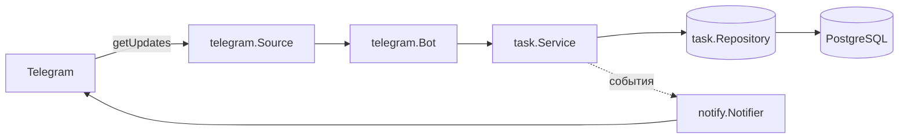

# TaskManagerBot

[](https://github.com/necanagc/ClerkControl/actions/workflows/ci.yml)

Telegram-бот для управления задачами: личный список в личных сообщениях и общий — в группе.
Задачи создаются, назначаются на исполнителя и закрываются прямо в чате, без внешней панели.

> 🚧 **Проект в активной разработке.**
> Основной сценарий работает и покрыт тестами, но интерфейс, тексты и схема данных ещё меняются.
> Команды и формат `callback_data` могут поменяться без обратной совместимости.

## Что уже работает

- приветствие `/start` с меню на inline-кнопках;
- создание задачи: `/new Купить хлеб` — сразу, `/new` без текста или кнопка «➕ Новая задача» — диалогом (бот присылает приглашение, вы отвечаете названием);
- три среза списка: `/tasks` (все открытые), `/my` (на мне), `/owner` (созданные мной);
- пагинация по 5 задач: сообщение редактируется, а не плодит новые;
- взятие задачи на себя, снятие, закрытие — кнопками «✋ Взять», «↩️ Снять», «✅ Готово» и командами с ID;
- назначение на другого: `/assign_5 @username` или `/assign_5` ответом на сообщение человека;
- уведомления участникам при назначении, снятии и выполнении;
- хранение в PostgreSQL, миграции применяются при старте и встроены в бинарник;
- изоляция по чатам: задачи группы не смешиваются с личными;
- защита от повторной обработки одного и того же обновления (`update_id`);
- корректная остановка по `SIGINT`/`SIGTERM`;
- Docker-образ и CI (сборка, `vet`, тесты с Postgres).

## Известные ограничения

Это важно знать до того, как пробовать бота:

- **Работает только через long polling.** Webhook-режим ещё не реализован, поэтому боту не нужен
  публичный адрес, но держать его надо на машине с исходящим доступом.
- **В группах у бота включён privacy mode.** Он получает только команды, адресованные ему
  (`/new@имя_бота`), ответы на свои сообщения и нажатия на свои кнопки. Обычный `/new` в группе
  до бота не дойдёт — это поведение Telegram, а не ошибка. Отключается в @BotFather → `/setprivacy`,
  после чего бота нужно удалить из группы и добавить заново.
- **Задачи живут в границах чата.** Личные задачи не видны в группе и наоборот: `chat_id` — это
  разделитель. «Общий список» появляется только в самой группе.
- **Личные уведомления приходят только тем, кто уже писал боту.** Telegram не позволяет
  отправить сообщение пользователю, который не начинал диалог; такие попытки пишутся в лог.
- **Нет веб-панели и Mini App.** Всё управление — в чате.
- **Нет редактирования задач**: изменить можно только исполнителя и статус.

## Быстрый старт

Нужны: Go 1.27+, Docker и токен от [@BotFather](https://t.me/BotFather).

```bash
git clone git@github.com:necanagc/ClerkControl.git
cd ClerkControl

make db-up                 # 1. PostgreSQL в Docker (порт только на 127.0.0.1)
cp .env.example .env       # 2. вписать TG_TOKEN в .env
make run                   # 3. миграции + запуск бота
```

Ожидаемые строки в логе:

```
level=INFO msg="storage ready" driver=postgres
level=INFO msg="starting" bot=my_bot mode=polling
```

Дальше в Telegram: `/start`, затем `/new Починить деплой` и `/tasks`.
Остановить бота — `Ctrl+C`, базу — `make db-down`.

### Проверка, что всё работает

```bash
make db-psql
# внутри psql:
\dt          # таблицы tasks, users, goose_db_version
\q
```

### Если что-то не так

| Симптом | Причина | Что делать |
|---|---|---|
| `config: TG_TOKEN не задан` | нет `.env` или пустой токен | `cp .env.example .env`, вписать токен |
| `postgres: ping` при старте | база не поднялась или занят порт 5432 | `make db-up`, `docker compose ps` |
| `bind: address already in use` при `db-up` | локальный PostgreSQL уже слушает 5432 | поменять порт в `docker-compose.yml` на `5433` и в `DATABASE_URL` |
| нет таблицы `tasks` | том создан старым запуском, `init.sql` не выполнялся | `make db-reset` |
| кнопки не реагируют | запущена старая сборка | перезапустить бота |
| в группе `/new` молчит | privacy mode | `/new@имя_бота` или отключить privacy |
| `Unauthorized` | токен отозван или неверный | перевыпустить в @BotFather |

### Запуск без базы

Если `DATABASE_URL` пуст, бот поднимается на хранилище в памяти: удобно для демонстрации,
но задачи исчезнут при перезапуске. В лог пишется предупреждение.

### Запуск в Docker целиком

```bash
cp .env.example .env       # вписать TG_TOKEN
docker compose --profile full up -d --build
docker compose logs -f bot
```

## Команды

| Команда | Действие |
|---|---|
| `/start` | приветствие и меню |
| `/help` | справка |
| `/new <текст>` | создать задачу |
| `/new` без текста | начать диалог: бот попросит название |
| `/tasks` | все открытые задачи чата |
| `/my` | задачи на мне |
| `/owner` | созданные мной |
| `/assign_<id>` | назначить на себя |
| `/assign_<id> @username` | назначить на другого |
| `/assign_<id>` в ответ на сообщение | назначить на автора того сообщения |
| `/unassign_<id>` | снять с себя |
| `/resolve_<id>` | отметить выполненной |
| `/cancel` | отменить ввод названия |

Кнопки под задачами делают то же самое: «✋ Взять», «✅ Готово», «↩️ Снять», «📋 К списку»,
«🙋 Мои», «➕ Новая задача», «ℹ️ Помощь».

## База данных

PostgreSQL 16 в контейнере, порт опубликован только на `127.0.0.1`.

```bash
make db-up      # поднять
make db-psql    # psql внутри контейнера
make db-reset   # снести том и поднять заново (данные пропадут)
```

```sql
tasks(id, chat_id, title, creator_id, creator, assignee_id, assignee, done)
users(id, username, first_name, updated_at)
```

`users` — все, кто хоть раз писал боту; нужна, чтобы превратить `@username` в `id`
(в Telegram API нет обратного поиска). Ник обновляется при каждом сообщении,
поиск регистронезависимый.

Параметры `chat_id` в запросах явно кастуются к `bigint`: идентификаторы групп
(`-5477175719`) не помещаются в `int4`, а Postgres выводит тип параметра из литерала `0`
в условии `chat_id = $1 OR $1 = 0`. Без каста операции в группах падали на кодировании аргумента.

Индексы под конкретные запросы:

| Индекс | Для чего |
|---|---|
| `tasks_chat_open_idx (chat_id, id) WHERE NOT done` | `/tasks` — открытые задачи чата |
| `tasks_assignee_idx (chat_id, assignee_id) WHERE assignee_id IS NOT NULL` | `/my` |
| `tasks_creator_idx (chat_id, creator_id)` | `/owner` |

Частичные индексы выбраны осознанно: закрытые задачи не нужны в двух из трёх запросов.

**Миграции** лежат в `internal/storage/postgres/migrations`, встраиваются через `embed`
и применяются `goose` при старте. Драйвер — `pgx/v5` с пулом соединений,
на миграции отведено 30 секунд.

## Docker

`deploy/Dockerfile` — multi-stage: сборка в `golang:1.27-alpine`, запуск в
`gcr.io/distroless/static-debian12:nonroot`.

- `CGO_ENABLED=0` — статический бинарник, без libc в финальном образе;
- `-trimpath`, `-ldflags="-s -w"` — воспроизводимая сборка и меньший размер;
- non-root пользователь;
- distroless содержит CA-сертификаты, поэтому HTTPS к Telegram работает.

Приложение не стартует раньше базы: `depends_on: condition: service_healthy`.

## Архитектура



- `telegram` — транспорт: приём обновлений, разбор команд, кнопки, сообщения;
- `task` — домен и сценарии: что можно делать с задачей и какие ошибки при этом бывают;
- `user` — справочник «ник → id» для назначения на другого;
- `storage` — реализации `task.Repository` (память и PostgreSQL);
- `notify` — реакция на события сервиса (кому и что написать);
- `cmd/bot` — сборка зависимостей и жизненный цикл процесса.

`task` не импортирует ничего из проекта — это граница, ради которой всё разделено.
Транспорт (polling, позже webhook) и хранилище подставляются в `main`.

## Структура

```
cmd/bot/                          точка входа, выбор хранилища, сигналы
internal/config/                  настройки из окружения и .env
internal/task/                    модель, ошибки, интерфейс хранилища, сценарии
internal/user/                    справочник пользователей (username → id)
internal/storage/memory/          хранилище в памяти (для тестов)
internal/storage/postgres/        пул pgx, SQL-репозиторий, миграции
internal/notify/                  уведомления по событиям сервиса
internal/telegram/                источник обновлений, роутинг, кнопки, рендеринг
deploy/Dockerfile                 сборка образа приложения
deploy/postgres/init.sql          создание тестовой базы при первом запуске
.github/workflows/ci.yml          CI: форматирование, vet, тесты, сборка образа
```

## Решения и почему именно так

**Хранилище за интерфейсом.** `task.Repository` объявлен в домене, реализации — снаружи.
Это позволяет держать быстрые тесты логики на памяти и подключать PostgreSQL без правок сервиса.

**Чат как арендатор.** `Task.ChatID` одновременно решает две задачи: в личке задачи приватны
(там `chat_id` равен `user_id`), в группе — общие. Отдельная сущность «команда» не понадобилась.

**Источник обновлений за интерфейсом.** `telegram.Source` скрывает разницу между long polling и
webhook: обработчики команд не знают, откуда пришло сообщение, поэтому переход на webhook —
это добавление одной реализации, а не переписывание логики.

**Дедупликация `update_id`.** Telegram повторяет доставку, если не получил подтверждение;
повторное выполнение команды не должно создавать вторую задачу или второе уведомление.

**Миграции в бинарнике.** `embed` + `goose`: деплой не требует ни CLI, ни отдельных файлов,
а версия схемы хранится в таблице `goose_db_version`.

**Диалог вместо аргумента команды.** Меню Telegram отправляет команду без параметров,
поэтому пустой `/new` запускает диалог, а не считается ошибкой. Приглашение привязано
к паре «чат + пользователь»: ответить за коллегу нельзя.

## Тесты

```bash
make test       # юнит-тесты, без инфраструктуры
make db-up
make test-db    # интеграционные тесты репозитория на реальном PostgreSQL
```

Покрыто: сценарии сервиса, обработчики команд и кнопок, репозиторий PostgreSQL
(включая групповые `chat_id`), справочник пользователей.
Интеграционные тесты пропускаются без `TEST_DATABASE_URL`, поэтому `make test`
работает на чистой машине. В CI база поднимается сервисным контейнером.

## CI

`.github/workflows/ci.yml` на каждый push и pull request: `gofmt`, `go vet`,
`go test -race` (с Postgres), сборка бинарника и Docker-образа.

## План

- [x] вынести домен, хранилище и транспорт в отдельные пакеты
- [x] long polling, graceful shutdown, дедупликация обновлений
- [x] PostgreSQL: пул соединений, миграции, индексы
- [x] Docker-образ и compose
- [x] CI: `gofmt`, `vet`, тесты с Postgres, сборка образа
- [x] inline-кнопки, приветствие и пагинация списка
- [x] диалог создания задачи и назначение на другого
- [ ] webhook-режим и `/healthz` для сервера
- [ ] сроки выполнения и напоминания
- [ ] редактирование и удаление задач
